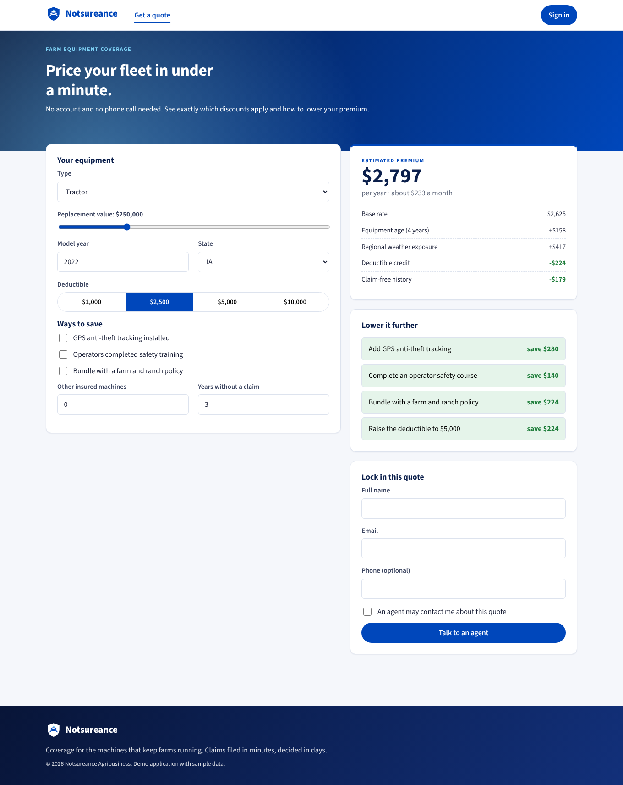
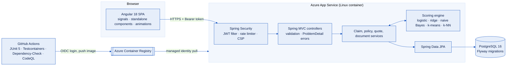
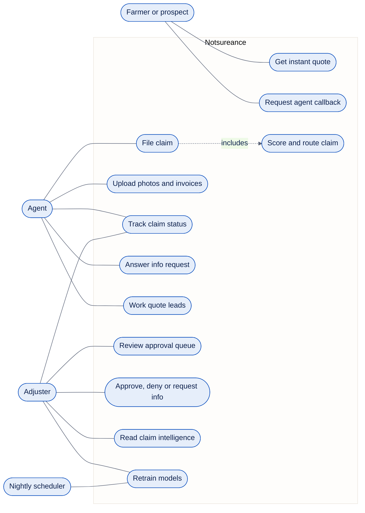
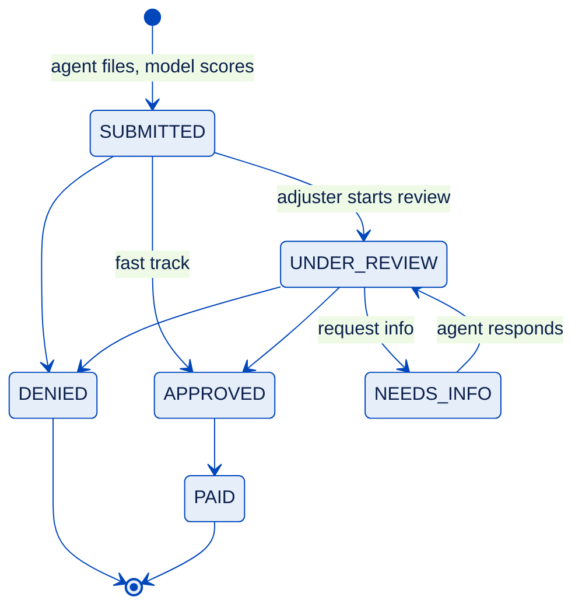
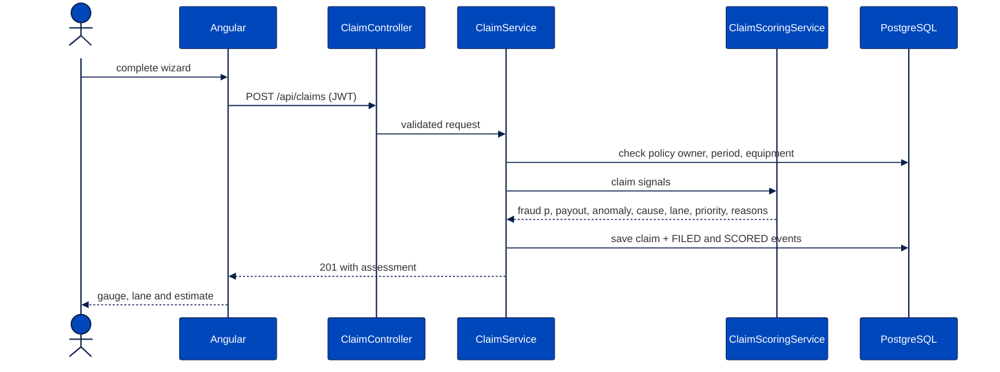

<p align="center"></p>

<p align="center">
  <a href="../../actions/workflows/ci.yml"></a>
  <a href="../../actions/workflows/codeql.yml"></a>
  
  
  
  
</p>

Farm equipment insurance claims for a Commercial Agribusiness team. Agents file claims for damaged tractors, combines,
sprayers and pivots from the field. Every claim is scored the moment it lands: fraud risk, expected payout, loss
anomaly and the most likely cause read from the description. Adjusters work a priority queue, fast-track clean losses
with one click and send suspicious ones to investigation. Their decisions feed the models back on a nightly retrain.

| Dashboard | Claim intelligence |
| --- | --- |
|  |  |
| **Approval queue** | **Instant quote** |
|  |  |

## Features

| Area | What it does |
| --- | --- |
| File a claim | Four-step wizard, policy and equipment pickers, GPS capture from the field, harvest-critical flag |
| Track | Search, filter by status and lane, sort by priority, fraud risk or loss size, full event timeline |
| Approve | Lane board for adjusters, one-click fast-track approval at the model estimate, approve / deny / request info |
| Documents | Photo and PDF upload checked by magic bytes, SHA-256 de-duplication, size and count limits |
| Claim intelligence | Calibrated fraud probability with top reasons, payout estimate, anomaly z-score, cause-vs-text check, similar decided claims |
| Instant quote | Public premium calculator with itemized discounts and "save $X by…" suggestions |
| Lead pipeline | Quote requests auto-routed to the least-loaded agent, kanban with win rate and pipeline premium |
| Portfolio segments | k-means groups policies into Steady, Watch and Elevated with a retention or loss-control play for each |
| Model insights | Holdout and cross-validated metrics, confusion matrix, learned weights, retrain on demand |

### Growth ideas built in

The quote flow borrows what comparison sites do well (instant price, no account, visible discounts) and points it at
farm equipment, where buyers usually wait on a phone call. Three features target revenue and loss ratio directly:

1. **Straight-through processing.** Small, clean claims skip the inspection step. Faster payouts are the strongest
   driver of renewal in commercial lines, and the adjuster hours go to the claims that need them.
2. **Downtime-aware priority.** A broken combine in October costs a farm far more than the repair. Claims flagged as
   harvest critical, or filed in planting and harvest windows, move up the queue.
3. **Risk-based upsell.** Segments and quote suggestions turn model output into agent actions: GPS trackers for
   theft-exposed fleets, safety courses, bundles and higher deductibles.

## Architecture



One image serves both the API and the compiled Angular app, so there is no CORS in production and one thing to deploy.

## Use cases



## Claim lifecycle



Transitions live in `ClaimStatus.nextAllowed()`; anything else returns 422. Optimistic locking returns 409 when two
adjusters act on the same claim.

## Filing and scoring



## Machine learning

Everything is implemented from scratch in `ml/core` so the maths is visible and unit tested, with no Python sidecar to
operate. Each piece maps to a topic on the [roadmap.sh machine learning path](https://roadmap.sh/machine-learning).

| Roadmap topic | Where it is used |
| --- | --- |
| Logistic regression, L2 regularization, gradient descent | Fraud classifier (`LogisticRegression`) |
| Class imbalance, probability calibration | Class-weighted training, then prior correction (King and Zeng, 2001) so 0.4 means 40% |
| Linear / ridge regression, normal equations | Payout ratio model (`RidgeRegression`, Gaussian elimination) |
| Naive Bayes, tokenization, Laplace smoothing | Reads the description and flags a mismatch with the stated cause |
| Feature engineering and scaling | Loss-to-value, policy age decay, reporting delay, theft without GPS, z-scored inputs |
| Anomaly detection | Per-category z-score of log loss-to-value (`AnomalyBaseline`) |
| k-means, k-means++ | Policy risk segments (`RiskSegmentationService`) |
| k-nearest neighbours | Similar decided claims and their outcomes (`SimilarClaimsService`) |
| Train/test split, k-fold CV, precision, recall, F1, ROC AUC, R² | `ModelTrainingService`, `ClassificationMetrics`, `RegressionMetrics` |
| Explainability | Per-claim contributions (weight × standardized value) shown as "why the model scored it this way" |
| Online feedback | Adjuster decisions (approved amounts, confirmed fraud) are added to training data on each retrain |

Current holdout numbers: fraud ROC AUC ≈ 0.94–0.97, recall ≈ 0.70 at the 0.4 investigation threshold, payout R² ≈ 0.85.

> **Read these numbers with suspicion.** There is no public farm claims dataset, so training data comes from
> `SyntheticClaimFactory`, a generator with known class-conditional patterns. The models are recovering structure I
> put there. The cause classifier's 100% is the clearest symptom: descriptions come from a phrase bank. Swap in
> historical claims through `TrainingFeedbackSource` before trusting any threshold, and expect AUC to drop.

## Security

- Stateless JWT (HS256, issuer and audience checked, 60 minute expiry); the user is reloaded per request so a
  deactivated account loses access immediately. Secrets under 32 bytes stop the app at startup.
- Role checks on routes and with `@PreAuthorize`. Agents only see their own policies and claims; other records return
  404, not 403, so ids cannot be probed.
- BCrypt cost 12, per-IP rate limits on login, quotes and lead capture, uniform login error message.
- Bean Validation on every request, `ProblemDetail` errors without stack traces, LIKE wildcards escaped, sort fields
  whitelisted, page size capped.
- Uploads checked by file signature rather than name or header, filenames sanitized, served as attachments with `nosniff`.
- Strict CSP, HSTS, `frame-ancestors 'none'`, referrer policy. Open-in-view off, actuator limited to health.
- Demo accounts live in a separate Flyway location that is only loaded when asked for.
- CI runs OWASP Dependency-Check (fails at CVSS 9), `npm audit`, CodeQL `security-extended` and Dependabot.

Known trade-off: the token sits in `sessionStorage`, readable by any script that gets past the CSP. An HttpOnly cookie
plus CSRF tokens is stronger and is the next step if this leaves demo territory.

## Run it

```bash
cp .env.example .env && docker compose up --build
```

Open http://localhost:8080. Every demo account uses the password `Harvest#2026`:
`agent@notsureance.dev`, `agent2@notsureance.dev`, `adjuster@notsureance.dev`, `adjuster2@notsureance.dev`.

For development, run Postgres from compose, then the API and the Angular dev server (proxies `/api` to 8080):

```bash
(cd backend && SPRING_PROFILES_ACTIVE=dev mvn spring-boot:run) & (cd frontend && npm ci && npm start)
```

Swagger UI is at `/swagger-ui.html` under the dev profile.

## Tests

```bash
(cd backend && mvn verify) && (cd frontend && npm run test:ci)
```

The backend runs 26 unit tests and 11 integration tests against a real PostgreSQL 16 in Testcontainers (auth,
throttling, the full claim lifecycle, ownership rules, uploads, quotes). Docker must be running.

## Deploy to Azure

`infra/azure/main.bicep` creates the registry, App Service plan, Linux Web App with a managed identity that pulls from
ACR, and PostgreSQL Flexible Server.

```bash
az deployment group create -g <resource-group> -f infra/azure/main.bicep -p databasePassword=<pw> jwtSecret=<secret>
```

Then set repository secrets `AZURE_CLIENT_ID`, `AZURE_TENANT_ID`, `AZURE_SUBSCRIPTION_ID` (federated credential for
OIDC, no client secret) and variables `AZURE_WEBAPP_NAME`, `AZURE_REGISTRY`. Every green CI run on `main` builds the
image, pushes it to ACR, deploys and smoke-tests the readiness probe. Add `NVD_API_KEY` to speed up Dependency-Check.

## Project layout

`backend/` holds the API by domain (`claim`, `policy`, `quote`, `document`, `analytics`, `security`, `ml/core`,
`ml/scoring`, `ml/insight`). `frontend/` splits into `core`, `shared` and one folder per screen under `features`.
`infra/azure` has the Bicep and `.github` the pipelines. No source file is longer than 250 lines. The one exception in the repository is `frontend/package-lock.json`, which is
generated and kept on purpose: deleting it would make installs non-reproducible and weaken the supply-chain checks.

## Design

Colours follow the Nationwide palette (Nationwide blue `#0047BB`, deep navy, sky accent) so the app feels at home next
to the existing agribusiness tools. The logo is an original mark, a shield with field rows, rather than the Nationwide
eagle, which is a registered trademark. Nationwide's typeface is proprietary, so the UI uses Source Sans 3, a humanist
sans with similar proportions. Motion is purposeful and short: route transitions, staggered lists, animated gauges and
counters, and all of it switches off under `prefers-reduced-motion`.
