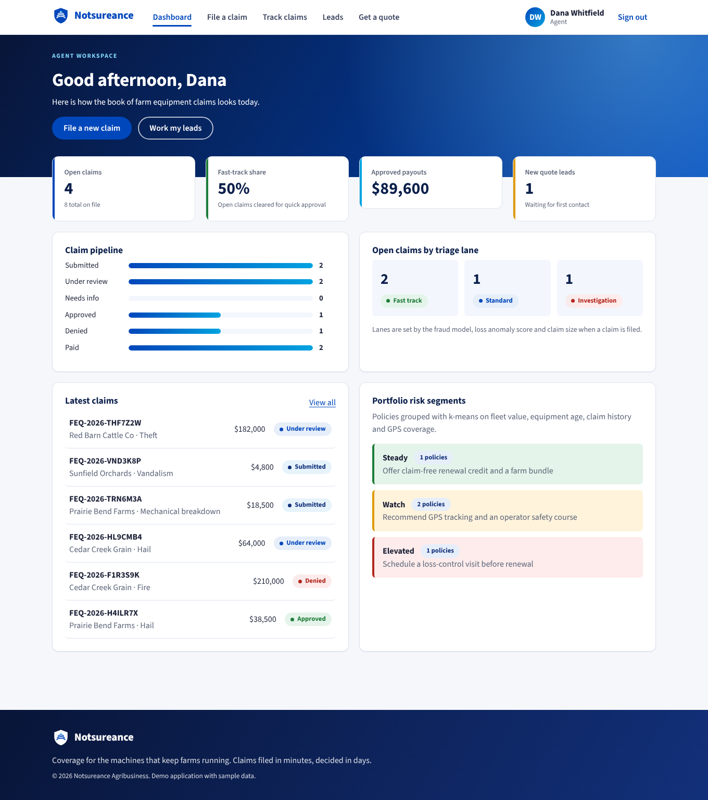
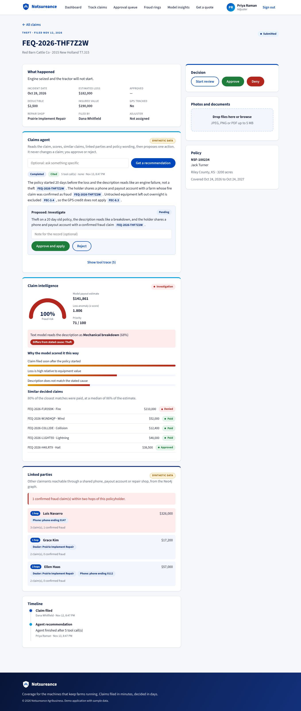
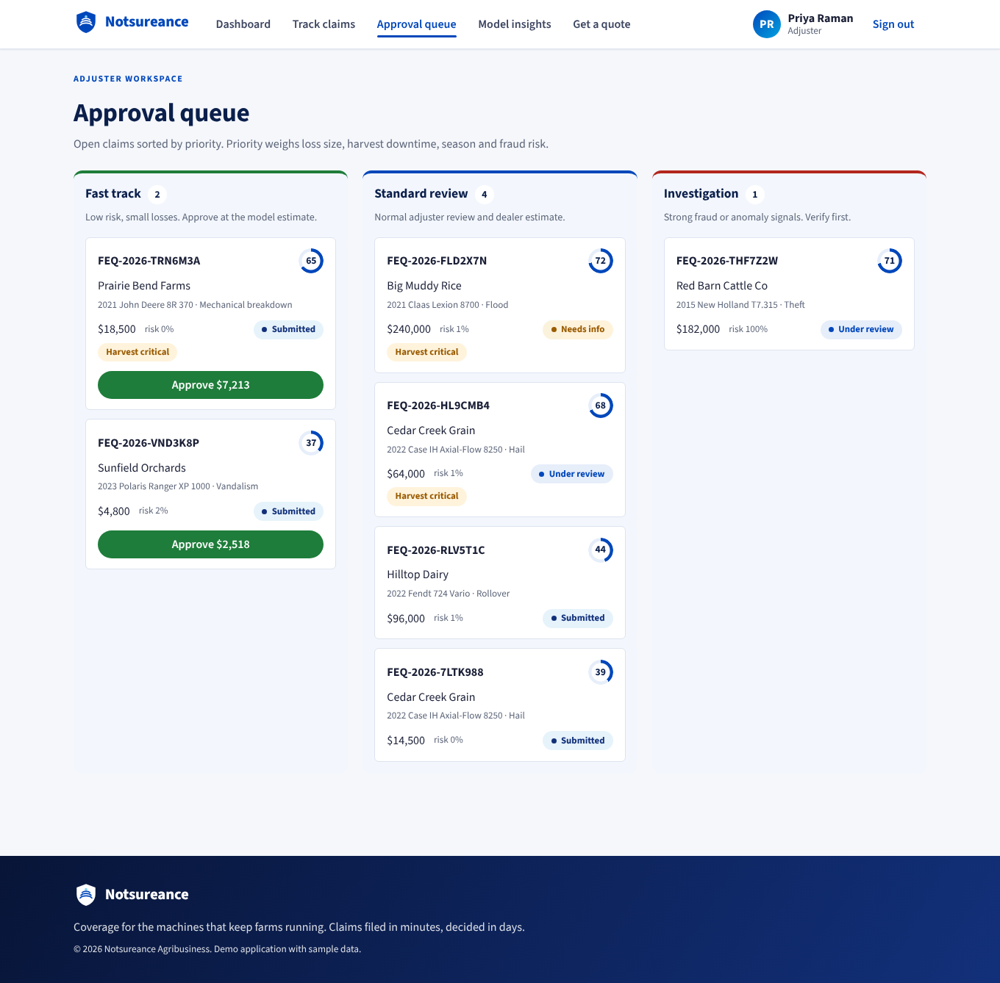
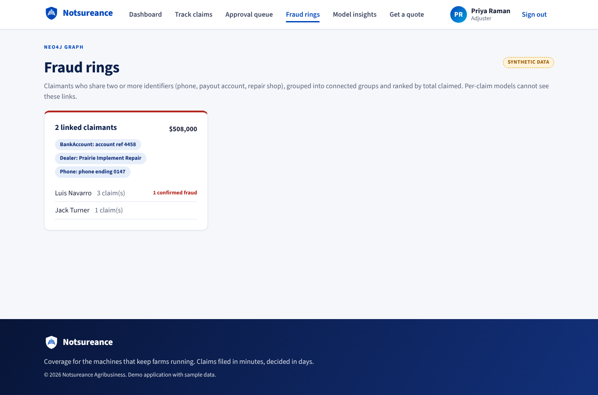
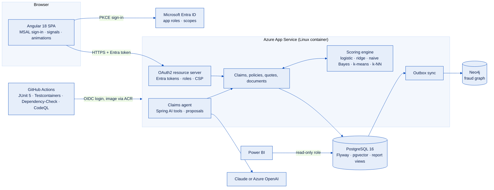
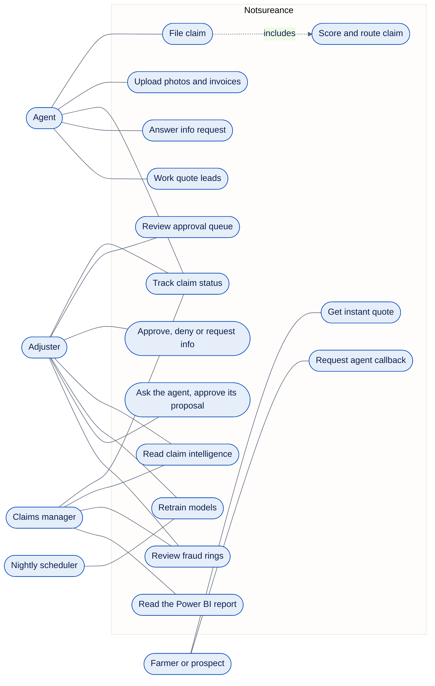
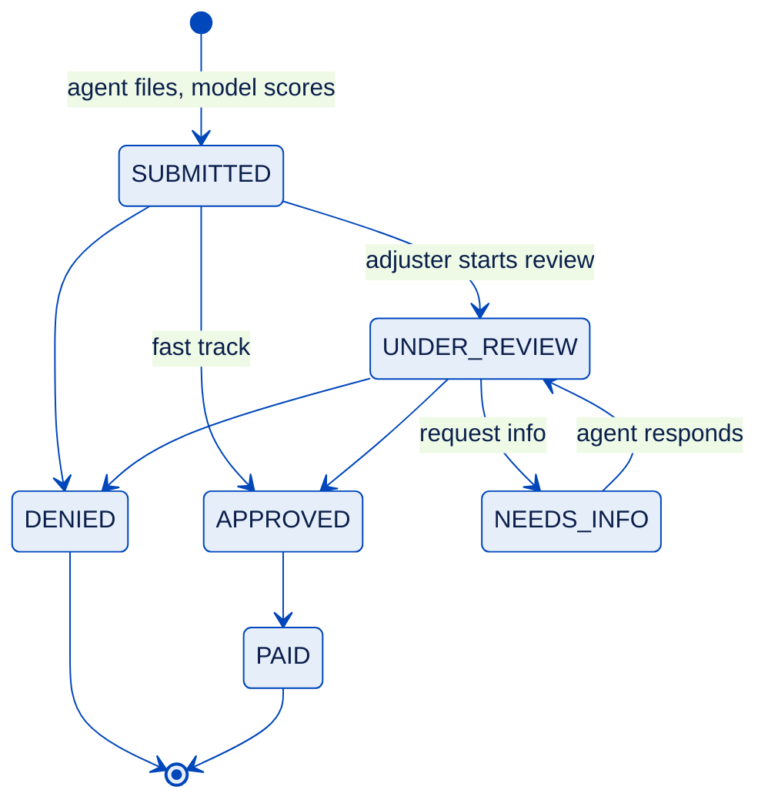
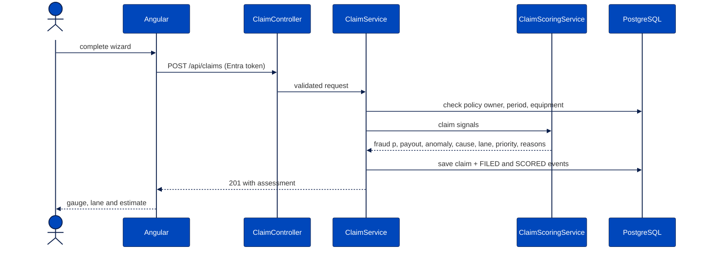

<p align="center"></p>

<p align="center">
  <a href="../../actions/workflows/ci.yml"></a>
  <a href="../../actions/workflows/codeql.yml"></a>
  
  
  
  
</p>

Farm equipment insurance claims for a Commercial Agribusiness team. Agents file claims for damaged tractors, combines,
sprayers and pivots from the field. Every claim is scored the moment it lands: fraud risk, expected payout, loss
anomaly and the most likely cause read from the description. Adjusters work a priority queue, fast-track clean losses
with one click and send suspicious ones to investigation. A tool-calling claims agent reads the claim, similar claims,
a Neo4j fraud-ring graph and the policy wording, then proposes an action that an adjuster must approve. Everyone signs
in with Microsoft Entra ID, and a Power BI report reads read-only views. All data is synthetic.

| Dashboard | Claim intelligence |
| --- | --- |
|  |  |
| **Approval queue with agent proposals** | **Fraud rings from Neo4j** |
|  |  |

## Features

| Area | What it does |
| --- | --- |
| File a claim | Four-step wizard, policy and equipment pickers, GPS capture from the field, harvest-critical flag |
| Track | Search, filter by status and lane, sort by priority, fraud risk or loss size, full event timeline |
| Approve | Lane board for adjusters, one-click fast-track approval at the model estimate, approve / deny / request info |
| Documents | Photo and PDF upload checked by magic bytes, SHA-256 de-duplication, size and count limits |
| Claim intelligence | Calibrated fraud probability with top reasons, payout estimate, anomaly z-score, cause-vs-text check, similar decided claims |
| Instant quote | Public premium calculator with itemized discounts and "save $X by…" suggestions |
| Lead pipeline | Quote requests auto-routed to the least-loaded agent, kanban with win rate and pipeline premium |
| Portfolio segments | k-means groups policies into Steady, Watch and Elevated with a retention or loss-control play for each |
| Model insights | Holdout and cross-validated metrics, confusion matrix, learned weights, graph lift, retrain on demand |
| Claims agent | Spring AI tool calling over six tools, cited answers, a proposal the adjuster approves, full tool trace |
| Fraud rings | Neo4j graph of shared phones, payout accounts and repair shops, linked parties within two hops, ring ranking |
| Policy search | Clause-level retrieval from pgvector, used by the agent so answers cite clause ids |
| Sign-in | Microsoft Entra ID (MSAL, Authorization Code with PKCE), app roles Agent, Adjuster and Manager |
| Manager report | Read-only reporting views for Power BI: loss ratio, funnel, cycle time, fraud by segment, agent overrides |

## Architecture



One image serves both the API and the compiled Angular app. The agent is the only part that calls a model, and every
tool it uses runs as the signed-in adjuster. Details: [claims agent, fraud graph and policy search](docs/agent-and-graph.md),
[product and design notes](docs/product-notes.md).

## Use cases



## Claim lifecycle



Transitions live in `ClaimStatus.nextAllowed()`; anything else returns 422. Optimistic locking returns 409 when two
adjusters act on the same claim.

## Filing and scoring



## Machine learning

Everything is implemented from scratch in `ml/core` so the maths is visible and unit tested, with no Python sidecar to
operate. Each piece maps to a topic on the [roadmap.sh machine learning path](https://roadmap.sh/machine-learning).

| Roadmap topic | Where it is used |
| --- | --- |
| Logistic regression, L2 regularization, gradient descent | Fraud classifier (`LogisticRegression`) |
| Class imbalance, probability calibration | Class-weighted training, then prior correction (King and Zeng, 2001) so 0.4 means 40% |
| Linear / ridge regression, normal equations | Payout ratio model (`RidgeRegression`, Gaussian elimination) |
| Naive Bayes, tokenization, Laplace smoothing | Reads the description and flags a mismatch with the stated cause |
| Feature engineering and scaling | Loss-to-value, policy age decay, reporting delay, theft without GPS, z-scored inputs |
| Anomaly detection | Per-category z-score of log loss-to-value (`AnomalyBaseline`) |
| k-means, k-means++ | Policy risk segments (`RiskSegmentationService`) |
| k-nearest neighbours | Similar decided claims and their outcomes (`SimilarClaimsService`) |
| Train/test split, k-fold CV, precision, recall, F1, ROC AUC, R² | `ModelTrainingService`, `ClassificationMetrics`, `RegressionMetrics` |
| Explainability | Per-claim contributions (weight × standardized value) shown as "why the model scored it this way" |
| Online feedback | Adjuster decisions (approved amounts, confirmed fraud) are added to training data on each retrain |
| Graph features | Confirmed fraud within two hops in Neo4j, measured against the same model without it |

Default training run: fraud ROC AUC 0.974 (0.951 without the graph feature), recall about 0.70 at the 0.4
investigation threshold, payout R² about 0.85.

> **Read these numbers with suspicion.** There is no public farm claims dataset, so training data comes from
> `SyntheticClaimFactory`, a generator with known class-conditional patterns. The models are recovering structure I
> put there. The cause classifier's 100% is the clearest symptom: descriptions come from a phrase bank. Swap in
> historical claims through `TrainingFeedbackSource` before trusting any threshold, and expect AUC to drop.

## Security

- Microsoft Entra ID tokens checked for signature, issuer, audience and expiry; app roles map to Spring authorities,
  `claims.read` gates reads and `claims.write` gates changes. Tokens live in MSAL's memory cache, not in storage.
- Entra says who you are, the database decides what you see: agents only see their own policies and claims, and
  other records return 404, not 403, so ids cannot be probed. Managers read everything but cannot decide.
- The agent only proposes; tools run as the signed-in adjuster and never return masked identifiers in clear text.
- Per-IP rate limits on the public quote and lead endpoints.
- Bean Validation on every request, `ProblemDetail` errors without stack traces, LIKE wildcards escaped, sort fields
  whitelisted, page size capped.
- Uploads checked by file signature rather than name or header, filenames sanitized, served as attachments with `nosniff`.
- Strict CSP, HSTS, `frame-ancestors 'none'`, referrer policy. Open-in-view off, actuator limited to health.
- Demo accounts live in a separate Flyway location that is only loaded when asked for.
- CI runs OWASP Dependency-Check (fails at CVSS 9), `npm audit`, CodeQL `security-extended` and Dependabot.

Integration tests mint their own RS256 tokens and run them through the same validators, so CI never calls Entra.

## Run it

Register the two Entra apps once (any tenant, the free tier works) and paste the printed values into `.env`:

```bash
cp .env.example .env && infra/entra/register-apps.sh http://localhost:8080
```

```bash
docker compose up --build
```

Open http://localhost:8080 and sign in as one of the Entra test users `agent@`, `adjuster@` or `manager@` your
tenant domain. Set `AGENT_MODEL=claude` and `ANTHROPIC_API_KEY`, or the Azure OpenAI variables, to turn on the agent.

For development, start `db` and `graph` from compose, then `mvn spring-boot:run` in `backend` with the `dev` profile
(Swagger UI at `/swagger-ui.html`) and `npm start` in `frontend`, which proxies `/api` to 8080.

## Tests

```bash
(cd backend && mvn verify) && (cd frontend && npm run test:ci)
```

34 unit and 29 integration tests run against real PostgreSQL 16 with pgvector and Neo4j 5 in Testcontainers (Entra
token checks, ownership, graph, retrieval, the agent with scripted model turns, report role), plus 10 Karma specs.

## Deploy to Azure

`infra/azure/main.bicep` creates the registry, App Service plan, a Linux Web App that pulls from ACR with a managed
identity, and PostgreSQL Flexible Server with pgvector allowed. Point `neo4jUri` at an AuraDB Free instance.

```bash
az deployment group create -g <rg> -f infra/azure/main.bicep -p databasePassword=<pw> entraTenantId=<id> entraApiAudiences=<aud> entraSpaClientId=<id> entraApiScopes=<scopes> neo4jUri=<uri> neo4jPassword=<pw>
```

Set repository secrets `AZURE_CLIENT_ID`, `AZURE_TENANT_ID`, `AZURE_SUBSCRIPTION_ID` (OIDC, no client secret) and
variables `AZURE_WEBAPP_NAME`, `AZURE_REGISTRY`; every green CI run on `main` then deploys and smoke-tests the app.

## Project layout

`backend/` holds the API by domain (`claim`, `policy`, `agent`, `graph`, `rag`, `ml`, `security` and more).
`frontend/` splits into `core`, `shared` and one folder per screen. `infra/` has the Bicep and Entra script,
`docs/powerbi` the [report setup](docs/powerbi/README.md). No source file is longer than 250 lines; the one exception,
`frontend/package-lock.json`, is generated and kept so installs stay reproducible and auditable.
