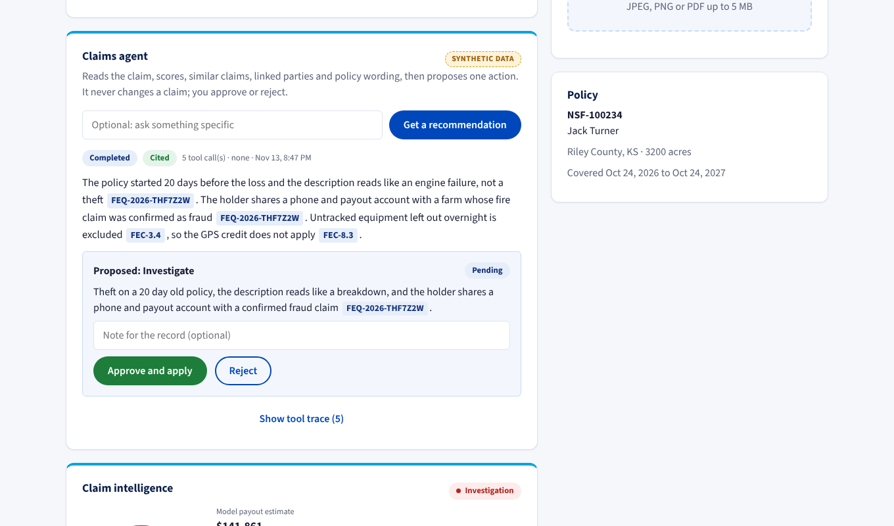
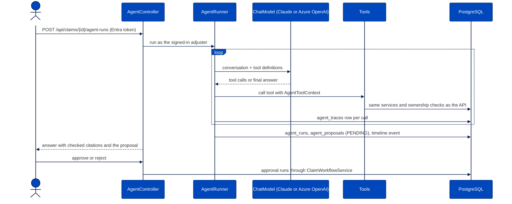
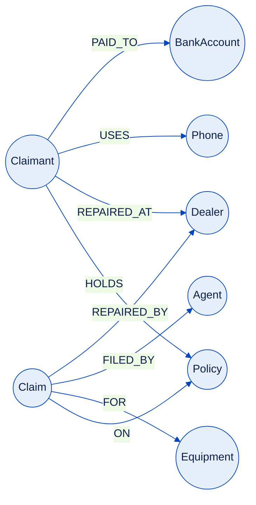
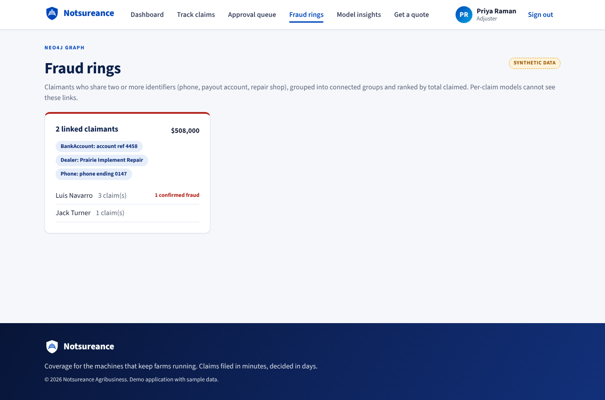

# Claims agent, fraud graph and policy search

All data behind these features is synthetic. Every screen that shows it carries a "Synthetic data" label.



## Claims agent

An adjuster opens a claim and asks for a recommendation. The agent calls read-only tools, cites what it found and
proposes one action. It never changes a claim: the proposal waits until an adjuster clicks Approve or Reject.



| Tool | Returns | Backed by |
| --- | --- | --- |
| `getClaim` | Claim fields, timeline notes, uploaded document names | `ClaimService`, `DocumentService` |
| `getScores` | Fraud probability and reasons, payout estimate, anomaly z-score, cause check, lane | `ClaimScoringService` |
| `findSimilarClaims` | Nearest decided claims and their outcomes | k-NN in `SimilarClaimsService` |
| `searchPolicyClauses` | Closest policy clauses with clause ids | pgvector in PostgreSQL |
| `findLinkedParties` | Claimants within two hops through a shared phone, payout account or repair shop | Neo4j |
| `proposeAction` | Saves FAST_TRACK, REQUEST_INFO or INVESTIGATE as a pending proposal | `agent_proposals` |

Guardrails:

- `AgentToolContext` carries the signed-in adjuster into every tool, so a tool can only return what that person
  can already see. Agents and managers cannot start a run.
- The loop is written by hand around Spring AI's `ChatModel` and `@Tool` methods so the six-call cap, the 30 second
  budget and the trace stay under our control. A tool error goes back to the model as a result; it does not end the run.
- An answer counts as supported only when it cites at least one id and every cited id came back from a tool in the
  same run. Anything else is shown as unsupported, and unknown ids are struck through.
- Graph identifiers reach the model masked (`phone ending 0147`, `account ref 4458`); bank numbers are stored only as
  salted hashes and never appear in a prompt.
- Model text is rendered as text, never as HTML.

### Choosing the model

`AGENT_MODEL=claude` uses `ClaudeChatModel`, a small Spring AI adapter on the official Anthropic Java SDK. It
defaults to `claude-opus-5-5` at medium effort, sends each assistant turn back unchanged so thinking blocks survive
the tool loop, turns on prompt caching, and opts into server-side refusal fallbacks (`CLAUDE_REFUSAL_FALLBACK=false`
turns that off). The key comes from `ANTHROPIC_API_KEY`.

`AGENT_MODEL=azure-openai` uses Spring AI's Azure OpenAI starter with `AZURE_OPENAI_ENDPOINT`,
`AZURE_OPENAI_API_KEY` and `AZURE_OPENAI_CHAT_DEPLOYMENT`. With `AGENT_MODEL=none` (the default) the agent endpoint
returns 503 and the rest of the app works as before.

Spring AI 2.x needs Spring Boot 4, so the app uses Spring AI 1.1 to stay on Boot 3.5.

### Evaluation

`backend/src/main/resources/agent-eval/cases.json` holds 30 synthetic claims with a known right action: ten fast
track, ten request info, ten investigate. Run them against a live model:

```bash
cd backend && SPRING_PROFILES_ACTIVE=dev,agent-eval AGENT_MODEL=claude mvn spring-boot:run
```

The run writes `agent-eval/report.json` (action match rate, citation rate, average tool calls) and
`agent-eval/recording.json` (every model reply). Copy both into `backend/src/test/resources/agent-eval/` and
`AgentEvalReplayIT` replays the recording in CI without a key. No live run has been recorded yet, so there are no
agent accuracy numbers to report.

## Fraud-ring graph

PostgreSQL stays the system of record. Claim changes write a row to `outbox_events` in the same transaction, and
`GraphSyncJob` replays them into Neo4j with `MERGE`, so replaying an event changes nothing.





- `GET /api/claims/{id}/linked-parties`: claimants reachable through shared identifiers, with hop count, the path
  and their confirmed fraud count.
- `GET /api/fraud/rings`: claimants sharing two or more identifiers, grouped into connected components and ranked
  by total claimed.

"Flagged" means confirmed fraud only, not a high model score, so a suspicious cluster cannot keep flagging itself.

### Graph feature in the fraud model

The count of confirmed fraud claims within two hops became the eleventh fraud feature. On the default training run
the holdout ROC AUC was 0.951 without it and 0.974 with it. Treat that gap with suspicion: the synthetic generator
puts ring links mostly on fraud cases, so the model is finding a pattern the generator planted. Model insights shows
both numbers after every retrain.

## Policy search (RAG)

The policy form in `backend/src/main/resources/policy/` is split into one chunk per clause and stored with a
384-dimension vector in `policy_clauses` (pgvector, HNSW index). The default embedder is a hashing embedder that runs
offline and gives the same vectors in every test. `RAG_EMBEDDER=spring-ai` switches to an Azure OpenAI embedding
deployment set to 384 dimensions. Only clauses whose text or embedder changed are re-embedded on startup.
